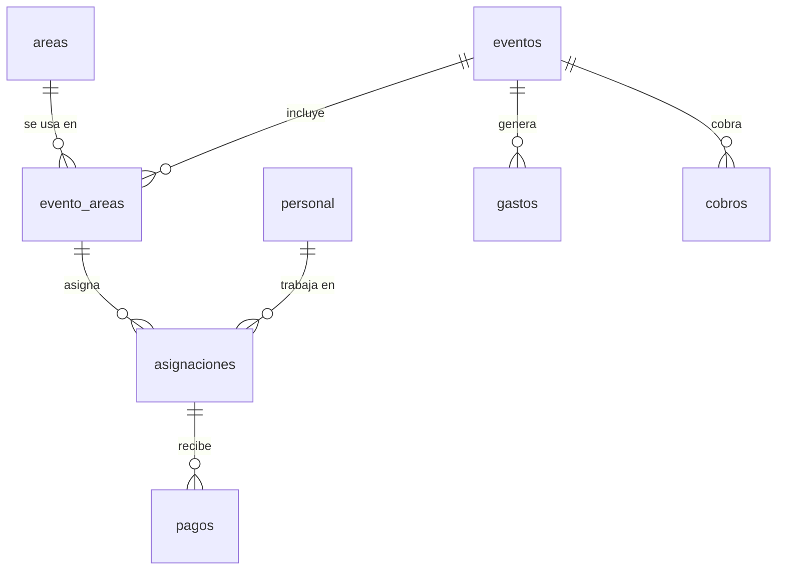

# Modelo de datos

El proyecto usa **Supabase (PostgreSQL)** como base de datos, API y autenticación. El frontend no
recalcula importes: los costos, pagos pendientes y ganancias se obtienen de vistas SQL de solo
lectura, de modo que la lógica financiera vive en un único lugar.

> Este documento describe el esquema que la aplicación espera encontrar en Supabase. La creación de
> tablas, vistas, políticas RLS y datos iniciales se administra directamente en el proyecto de
> Supabase.

## Relaciones



## Tablas

| Tabla          | Columnas                                                                                                     | Notas                                                                 |
| -------------- | ------------------------------------------------------------------------------------------------------------ | --------------------------------------------------------------------- |
| `personal`     | `id`, `nombre`, `telefono`, `documento`, `rol_habitual`, `tarifa_hora`, `activo`, `notas`                     | El personal se desactiva lógicamente; no se elimina.                  |
| `areas`        | `id`, `nombre`, `descripcion`, `activa`                                                                      | Catálogo de áreas operativas (cocina, meseros, barra, etc.).          |
| `eventos`      | `id`, `nombre`, `cliente`, `lugar`, `fecha`, `hora_inicio`, `hora_fin`, `num_invitados`, `ingreso_pactado`, `estado`, `notas` | `estado`: `borrador`, `confirmado`, `en_curso`, `finalizado`, `cancelado`. |
| `evento_areas` | `id`, `evento_id`, `area_id`, `tipo_pago`, `metodo_reparto`, `monto_area`                                     | Único por `(evento_id, area_id)`.                                     |
| `asignaciones` | `id`, `evento_area_id`, `personal_id`, `rol_en_evento`, `horas`, `tarifa_hora`, `pago_individual`, `notas`     | Único por `(evento_area_id, personal_id)`.                            |
| `pagos`        | `id`, `asignacion_id`, `monto`, `fecha`, `metodo`, `referencia`, `notas`                                      | `metodo`: `efectivo`, `transferencia`, `otro`.                        |
| `gastos`       | `id`, `evento_id`, `concepto`, `categoria`, `monto`, `fecha`                                                  | Gastos operativos del evento.                                         |
| `cobros`       | `id`, `evento_id`, `concepto`, `monto`, `fecha`, `metodo`                                                     | Pagos recibidos del cliente.                                          |

### Modalidad de pago por área

- `tipo_pago = 'individual'`: cada persona cobra según `pago_individual` o, si es nulo,
  `horas × tarifa_hora`.
- `tipo_pago = 'por_area'`: se reparte `monto_area` entre las personas asignadas al área, de forma
  `equitativo` o `por_horas` (`metodo_reparto`).

## Vistas de solo lectura

| Vista                   | Contenido                                                                                                                                                    |
| ----------------------- | ------------------------------------------------------------------------------------------------------------------------------------------------------------ |
| `v_asignaciones_detalle` | Detalle por asignación: evento, área, persona, rol, horas, modalidad y `monto_a_pagar` / `monto_pagado`.                                                    |
| `v_pagos_asignacion`     | La vista anterior más `monto_pendiente` y `estado_pago` (`pendiente`, `parcial`, `pagado`).                                                                  |
| `v_resumen_areas`        | Totales por área del evento: `num_personas`, `costo_area`, `pagado_area`.                                                                                    |
| `v_resumen_evento`       | Totales del evento: `ingreso_pactado`, `cobrado`, `costo_personal`, `total_gastos`, `personal_pagado` y `ganancia_neta`.                                      |
| `v_resumen_personal`     | Histórico por persona: `eventos_trabajados`, `horas_totales`, `total_ganado`, `total_pagado`, `total_pendiente`.                                              |

### Fórmulas de negocio

```text
monto_a_pagar    = pago_individual (si existe) o horas × tarifa_hora
monto_pendiente  = max(monto_a_pagar − monto_pagado, 0)
ganancia_neta    = ingreso_pactado − costo_personal − total_gastos
```

## Seguridad

- Activa **Row Level Security (RLS)** en todas las tablas.
- Restringe el acceso al rol `authenticated`; la aplicación está pensada para un usuario
  administrador.
- Usa únicamente la clave **anon/publishable** en el frontend. La clave `service_role` nunca debe
  exponerse en el cliente ni en el repositorio.
